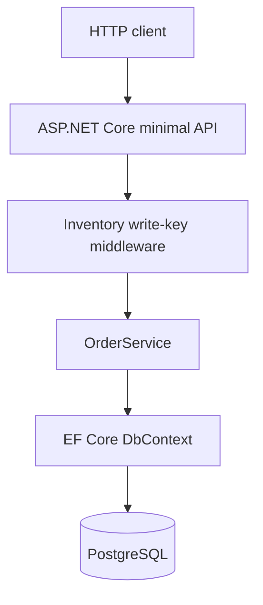
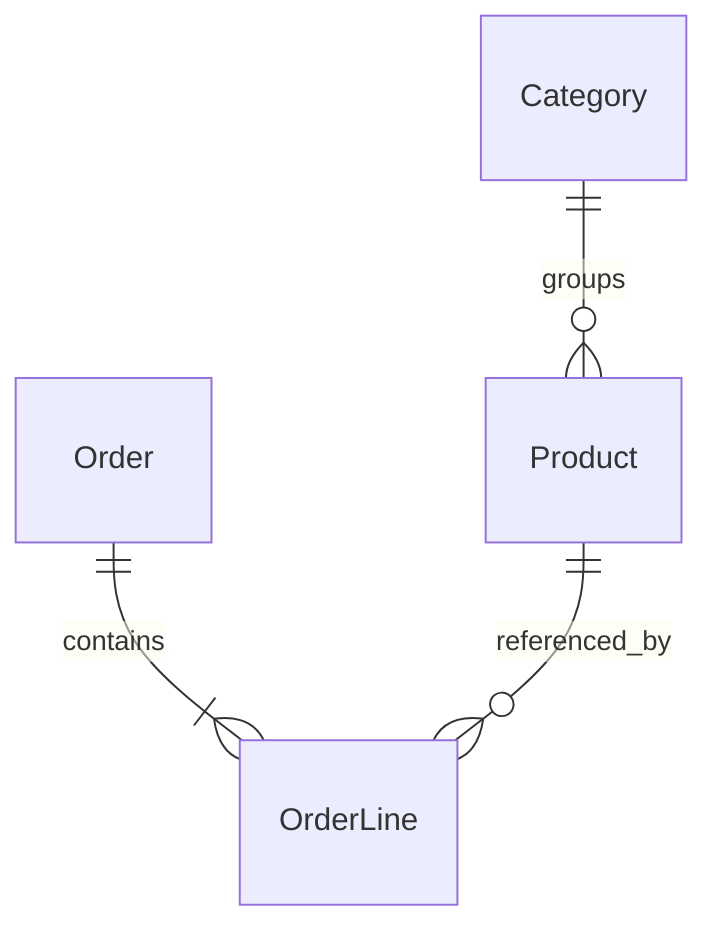

# Architecture — Inventory Order API

## Purpose

The main engineering problem is preventing overselling when orders reserve the same stock at the same time. The API models a small inventory system rather than a shopping frontend or a production ERP.

## Request flow

- `InventoryOrderApi/Program.cs`: routing, request validation and API responses.
- `InventoryOrderApi/Security/`: checks a configured key for modifying requests.
- `InventoryOrderApi/Services/OrderService.cs`: reservations, state transitions and stock adjustment transactions.
- `InventoryOrderApi/Domain/`: entities and a `Stock` value object used to express quantity invariants.
- `InventoryOrderApi/Data/`: EF Core database model and migrations.
- `InventoryOrderApi.Tests/`: domain tests, service/API tests and a PostgreSQL concurrency scenario.

## Data model

Product stores `OnHand` and `Reserved` quantities. An order has a status (`Reserved`, `Cancelled`, `Fulfilled`) and lines with product IDs, quantities and a unit-price snapshot.

## Invariants

- On-hand stock and reserved stock cannot be negative.
- `Reserved <= OnHand`.
- `Available = OnHand - Reserved`.
- A cancelled order releases reservations without decrementing on-hand stock.
- A fulfilled order decrements both on-hand and reserved quantities.
- An order can transition out of `Reserved` only once.
- Each product line retains its price at the moment the order is created.

The database also enforces the core stock invariant through a check constraint.

## Concurrency and transactions

During order creation:

1. Duplicate product IDs are combined into one line with a summed quantity.
2. A database transaction starts.
3. Each product is checked for active status and sufficient available stock.
4. A conditional EF Core `ExecuteUpdateAsync` increases reserved stock **only if availability remains sufficient**.
5. If any line fails, the transaction is rolled back. Otherwise the order and its lines are stored and the transaction commits.

The conditional update is important: a separate read followed by an unconditional update could let two parallel orders consume the same last units.

For cancellation/fulfillment, the order status is conditionally transitioned away from `Reserved` in the same transaction as the stock changes. PostgreSQL integration tests exercise simultaneous reservations.

## Authentication scope

Writes use a shared `X-Inventory-Key` configured through the environment; comparisons use hashed key material. This is a minimal demonstration gate, **not** full authentication or role-based authorization. Read endpoints are accessible without user identity. Public deployment would require scoped identities, read permissions, TLS, safe key rotation and an abuse-prevention strategy.

## Why these technologies?

- **ASP.NET Core:** small HTTP endpoints and dependency injection without an extra framework layer.
- **EF Core:** typed persistence, migrations and conditional updates.
- **PostgreSQL:** transactional consistency and realistic concurrent-write behavior.
- **SQLite in selected tests:** fast local integration checks, complemented by actual PostgreSQL tests for database-specific concurrency.
- **Docker Compose:** a repeatable local API + database environment.

## Intentional limitations

There are no customer accounts, stock movement audit log, idempotency keys or production-grade identity provider. This API is a testable backend exercise, not a complete warehouse system.
